<div align="center">

<a href="https://yujin-jeong.vercel.app">
  
</a>

<br/><br/>

### 기획부터 배포까지, 끝까지 밀고 가는 백엔드 개발자 정유진입니다.

사용자 인터뷰로 문제를 다시 정의하고, API와 데이터 구조를 설계해 구현한 뒤, 지표로 결과를 확인합니다.<br/>
서울여자대학교 소프트웨어융합학과 · 2027.02 졸업 예정

<br/>

<a href="https://yujin-jeong.vercel.app"></a>
<a href="https://velog.io/@yujindeang_/posts"></a>
<a href="https://www.instagram.com/greedy_uuu/"></a>
<a href="mailto:j_yujin_swu22@naver.com"></a>

</div>

<br/>

##  /experience

**FYI · 멋쟁이사자처럼 해외 신사업팀** — AI PM 인턴 · `2026.07 — 2026.08`

사용자 행동 데이터를 분석해 가입 퍼널과 운영 흐름을 개선하고, 문제 발견부터 개발, 지표 확인까지 직접 이어갔습니다.

<div align="center">
  
</div>

<br/>

| Step | Action |
|:--|:--|
| `01 발견` | 사용자 행동과 유입 퍼널을 점검해 이탈 구간과 계측 공백을 발견 |
| `02 연결` | 사용자 정보 회수 흐름을 랜딩 → API → DB → 이메일 발송 → 관리자 화면까지 연결 |
| `03 수정` | 페이지네이션 정렬 기준, 스크롤 도달 이벤트 누락, 빈 값 덮어쓰기 문제를 수정 |
| `04 실험` | A/B 실험용 사용자 식별·기능 분기와 운영 자동화, AI 추천 기능 구현 |

<br/>

##  /projects

| Status | Project | Role | Result |
|:--|:--|:--|:--|
| <code>202&nbsp;WIP</code> | [**오늘 시장은 (ReadEcon)**](https://yujin-jeong.vercel.app/projects/today-market)<br/>경제 입문자를 위한 LLM 기반 시장 흐름 학습 도우미 | PM · Backend | 🏆 ACK 2026 정총연합회 회장상 |
| <code>202&nbsp;WIP</code> | [**MOCA**](https://yujin-jeong.vercel.app/projects/moca)<br/>카페 운영자의 의사결정을 돕는 AI 경영 Agent | PM · Backend · UI | 🏆 멋사 중앙해커톤 247팀 중 상위 3%<br/>기업데이터 활용 AI 경진대회 본선 |
| <code>202&nbsp;WIP</code> | [**소프트웨어학과 홈페이지 리디자인**](https://yujin-jeong.vercel.app/projects/swu-software)<br/>정보 구조부터 관리자 기능까지 다시 설계한 학과 홈페이지 | 기획 · IA · Full-stack | 학과장 승인 · 교수 검토 완료 |
| <code>200&nbsp;DONE</code> | [**DDADANG**](https://yujin-jeong.vercel.app/projects/ddadang)<br/>혈당 관리를 꾸준히 이어가도록 돕는 헬스케어 플랫폼 | Backend | 🏆 메디럭스 25기 최우수상 |
| <code>200&nbsp;DONE</code> | [**Dentruth**](https://yujin-jeong.vercel.app/projects/dentruth)<br/>치과 일정과 상담 정보를 정리해 병원 방문 준비를 돕는 서비스 | Backend | 의료 도메인 API · 접근 제어 구현 |
| <code>200&nbsp;DONE</code> | [**돈워리**](https://yujin-jeong.vercel.app/projects/donworry)<br/>구매 직전의 소비 결정을 다시 생각하게 돕는 소비 절제 가계부 | Frontend · SWUWEB | 의사결정 시점에 개입하는 흐름 설계 |
| <code>200&nbsp;DONE</code> | [**서울여대 2025 축제 사이트**](https://yujin-jeong.vercel.app/projects/swu-festival-2025)<br/>실제 축제 이용자를 대상으로 운영된 축제 서비스 | Backend | 축제 기간 실서비스 운영 |

<details>
<summary><code>GET /projects?more=true</code></summary>
<br/>

| Year | Project | Note |
|:--|:--|:--|
| 2025 | Packingmate | SW GURU2 Android 앱 · 팀 우수상 |
| 2025 | GURU1 Python·HTML | 과정 수료 · 개인상 |
| 2024 | STACKPOT | UMC 협업 올인원 플랫폼 · PM |

</details>

<br/>

##  /experience/activities

| Period | Activity | Note |
|:--|:--|:--|
| `2026` | **UMC 10기** · 서버 파트 | JWT 인증·인가, 공통 응답·예외 처리, Public/Private API 구조 적용 |
| <code>2026.02&nbsp;—&nbsp;2026.10</code> | **SWUWEB** · 서울여대 소학회 4기 | 돈워리 프로젝트 프론트엔드 개발 |
| <code>2026.02&nbsp;—&nbsp;2026.08</code> | **메디럭스** · 메디컬 창업동아리 25기 | Dentruth·DDADANG 백엔드 개발, DDADANG 최우수상 |
| <code>2025.01&nbsp;—&nbsp;2026.01</code> | **멋쟁이사자처럼 중앙운영단** · 홍보부장 | 공식 SNS 콘텐츠 운영, 평균 조회수 약 9,500회 |
| <code>2024.12&nbsp;—&nbsp;2025.12</code> | **멋쟁이사자처럼 서울여대** · 백엔드 운영진 | 백엔드 교육 세션과 자체 행사 기획·운영 |
| <code>2024.09&nbsp;—&nbsp;2025.02</code> | **UMC 7기** · Plan 파트 | 서비스 기획 스터디, STACKPOT 프로젝트 PM |

<br/>

##  /stack

<div align="center">
  
  
  
  
  
  
  
  
  <br/>
  
  
  
  
  
</div>

<br/>

```ts
// stack.d.ts — 손에 익은 순서대로
export interface Stack {
  backend: ["Java", "Spring Boot", "JPA", "REST API", "JWT"];
  data_infra: ["MySQL", "PostgreSQL", "Redis", "AWS"];
  product_ai: ["Event Tracking", "A/B Test", "Python", "GPT API"];
  collab: ["React", "TypeScript", "GitHub", "Figma"];
  certificates: ["TOEIC 820", "SQLD", "정보처리기사 필기 합격"];
}
```

<br/>

<div align="center">
  <sub><code>200 OK</code> · 더 자세한 응답은 <a href="https://yujin-jeong.vercel.app">yujin-jeong.vercel.app</a> 에서</sub>
</div>
